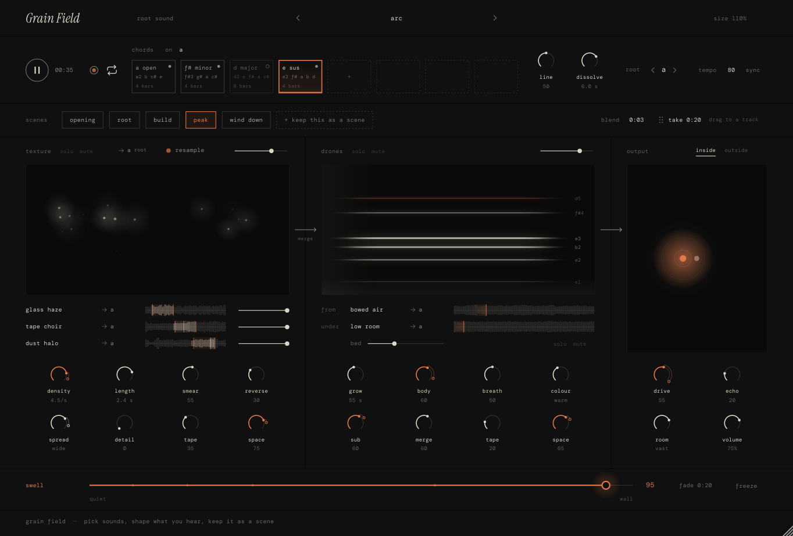

# Grain Field

A generative ambient instrument for macOS: granular textures, evolving drones, and layered harmony, shaped into pieces over time. No MIDI keyboard required.

**Version 0.7.0** · Audio Unit · VST3 · Standalone · Apple silicon + Intel

## What it does

- Blend three granular sound layers with drones and a background bed.
- Shape harmony with chord slots, layer tuning, or a MIDI keyboard.
- Keep sounds as scenes, blend between them, and automate changes in your DAW; shape intensity with **Swell**.
- Add tape, drive, echo, and reverb, or route four stereo outputs to your DAW.
- Import recordings, use side-chain input, resample, and record 24-bit WAV takes.

## Get started

Requires macOS 11+, Apple's command line tools, and internet access for the first build.

1. Clone this repository or download the source.
2. From the project folder, run `bash build-mac.sh` to build and install the plugins.
3. Load the AU in Logic Pro, the VST3 in Ableton Live, or open `build/GrainField_artefacts/Release/Standalone/Grain Field.app`.
4. Choose a preset with **‹ ›**, then press **play**. New instances start empty and stopped.

Prefer a cloud build? Open a successful [Actions run](https://github.com/wallstrom/grain-field/actions), download **Grain Field macOS** from its artifacts, and follow the [installation guide](docs/USER_GUIDE.md#1-build-it-on-your-mac).

## Status

Verified **v0.7.0** on **2026-11-11**:

- [GitHub Actions build passed](https://github.com/wallstrom/grain-field/actions/runs/43067279398), including packaging and artifact upload.
- Local functional tests passed: **40 audio checks in full mode and 6 synthetic UI checks**.
- Scene persistence, DAW scene automation, and transport sync checks passed.
- Manual listening, native window interaction, and real DAW integration remain unverified, as do distribution signing and notarization.

Scenes replace timed parts: there is no internal timeline or automatic play-through. Existing v0.6 parts load as scenes; automate the **Scene** parameter in your DAW to arrange transitions.

CI currently builds and packages; functional tests are run locally, not in CI. See the [test results](Tests/FunctionalTestResults.txt) for metrics, coverage, limitations, and historical v0.6 results.

## Documentation

- [User guide](docs/USER_GUIDE.md): installation, controls, composition, sounds, routing, and troubleshooting.
- [Developer reference](docs/USER_GUIDE.md#for-developers): source layout and architecture.
- [Running tests](docs/USER_GUIDE.md#running-the-functional-tests) and [recorded results](Tests/FunctionalTestResults.txt).

Built with **C++17, JUCE 8.0.15, and CMake**. Build outputs and downloaded tools are ignored by Git.

## Licensing

Grain Field's original code is licensed under the GNU Affero General Public License, version 3 only ([LICENSE](LICENSE)). JUCE is separately dual-licensed under AGPLv3 or its [commercial licence](https://juce.com/get-juce/); a commercial JUCE licence does not override Grain Field's own AGPL terms. Fonts remain under the SIL Open Font License, and bundled sounds retain their separate terms in [Resources/Sounds/CREDITS.txt](Resources/Sounds/CREDITS.txt). Release archives include the project license, font notices, and sound credits. See the [licensing notes](docs/USER_GUIDE.md#11-licence).
